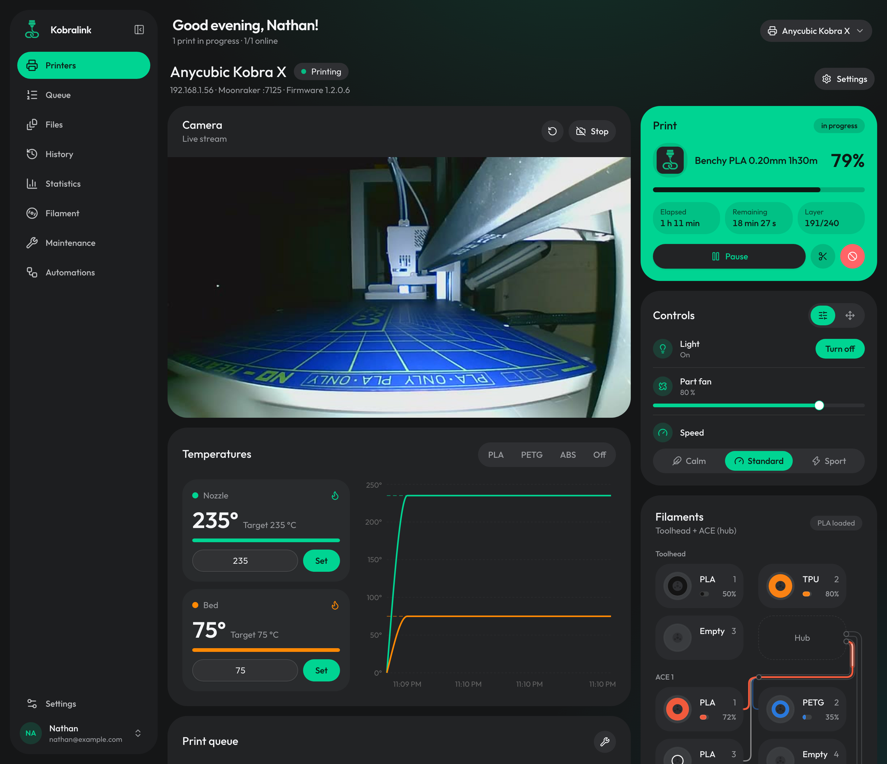

Kobralink macht einen **Anycubic Kobra X** oder **Kobra 4** zu einem **Moonraker-kompatiblen Drucker**. Kein Klipper, kein
Raspberry Pi, keine Firmware-Änderung: Kobralink spricht im LAN-Modus über Ihr Netzwerk mit dem Drucker und stellt ihn als
Moonraker-Server bereit.

Sie können den Drucker nutzen über:

- **OrcaSlicer**, der Drucke sendet und verfolgt
- das **Web-Dashboard**, das alles andere verwaltet
- **Moonraker-Clients** wie Mainsail, Fluidd, Obico oder Home Assistant
- einen **KI-Assistenten** (Claude, ChatGPT…) über den eingebauten MCP-Server

## Installationsart wählen

<Cards>
    <Card title="Docker" href="/de/docs/getting-started/docker">
        Empfohlen für einen dauerhaft laufenden Server: mehrere Drucker, mehrere Benutzer, Zugriff vom Smartphone.
    </Card>
    <Card title="Desktop-App" href="/de/docs/getting-started/desktop">
        Für einen einzelnen Computer mit macOS, Windows oder Linux. Sonst ist nichts zu installieren.
    </Card>
</Cards>

Folgen Sie dann dem [ersten Start](/de/docs/getting-started/first-run) und [verbinden Sie OrcaSlicer](/de/docs/getting-started/orcaslicer).

## Was Sie bekommen

| Bereich | Funktionen |
| --- | --- |
| [Dashboard](/de/docs/guide/dashboard) | Temperaturen, Fortschritt, Steuerung und Kamera live, für einen oder mehrere Drucker |
| [Drucken](/de/docs/guide/printing) | G-Code-Bibliothek, 3D-Vorschau, Filamentzuordnung, Objekte überspringen, geplante Starts |
| [Warteschlange](/de/docs/guide/queue) | Eine Warteschlange für alle Drucker, mit Kompatibilitäts- und Filamentprüfung |
| [Filament](/de/docs/guide/filament) | ACE-Slots, Trocknung, OrcaSlicer-Profile, Spoolman oder lokales Inventar |
| [Kamera](/de/docs/guide/camera) | Livestream, Schnappschüsse und Zeitraffer |
| [Fehlererkennung](/de/docs/guide/failure-detection) | Lokales KI-Modell, das benachrichtigt, pausiert oder abbricht |
| [Automatisierungen](/de/docs/guide/automations) und [Makros](/de/docs/guide/macros) | Regeln und Aktionsfolgen per Klick |
| [Statistiken](/de/docs/guide/statistics) | Verlauf, Kosten, Energie, Fehler, CSV-Export |
| [Wartung](/de/docs/guide/maintenance) | Aufgaben fällig nach Druckstunden, Anzahl Drucke oder Tagen |
| [Benachrichtigungen](/de/docs/guide/notifications) | Webhook, Discord, Telegram, ntfy, Web-Push |
| [Integrationen](/de/docs/integrations/moonraker) | Moonraker, Home Assistant, Spoolman, Prometheus, MCP |

Die Oberfläche gibt es auf Französisch, Englisch, Deutsch, Spanisch, Italienisch, vereinfachtem Chinesisch und brasilianischem
Portugiesisch.

<Callout type="warn" title="Bevor Sie anfangen">
    Der LAN-Modus trennt den Drucker von Ihrem Anycubic-Konto. Der Drucker akzeptiert nur eine LAN-Sitzung: Betreiben Sie
    Kobralink nicht gleichzeitig mit einem anderen LAN-Client (etwa Anycubic Slicer Next).
</Callout>

Kobralink ist ein unabhängiges Projekt unter der Lizenz GPL-3.0. Es steht in keiner Verbindung zu Anycubic.
